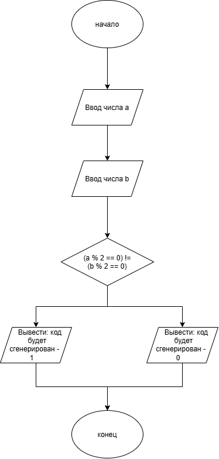

# Домашнее задание к работе 4

## Условие задачи

Банк отправляет клиенту секретный код для подтверждения операции. Код будет сгенерирован, если только одна из сумм (A или B) в последних двух операциях была четной. Запишите условие генерации кода.

---

## 1. Алгоритм и блок-схема

### Алгоритм

1. Объявить переменную `a` и `b`  типа `int`.
2. Запросить у пользователя две суммы операции (`a`, `b`).
3. Рассчитать остаток от деления и неравенство остатков `(a % 2 == 0) != (b % 2 == 0)`.
4. Вывести ответ.
5. Завершить программу.

## Блок-схема

---

## 2. Реализация программы
---

## 3. Результаты работы программы

Пример работы программы при вводе  **2025** и **2020** :

---

Введите сумму операции A: 2025

Введите сумму операции B: 2020

Код будет сгенерирован ( 1 - да, 0 - нет): 1

---

## 4. Информация о разработчике

- **ФИО:** Губский Данил Максимович
- **Группа:** бОТИ-261
